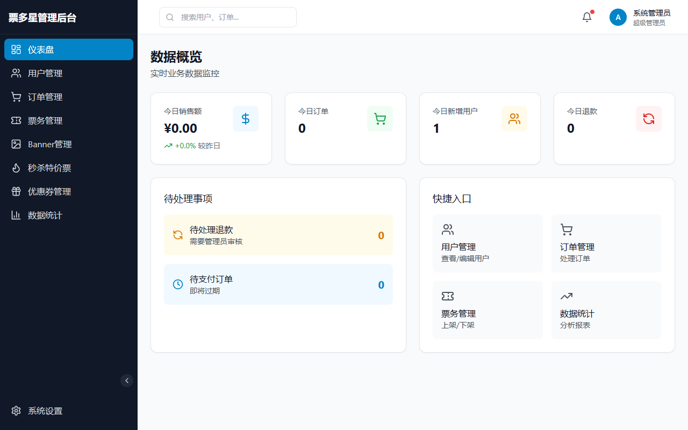
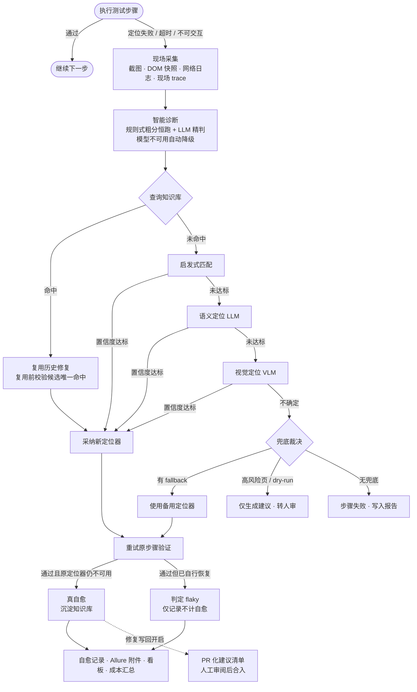

<!-- 本项目统一使用 UTF-8（无 BOM）编码。 -->
<div align="center">
  <h2>AutoAiSelfHeal</h2>

  <p>
    <a href="https://github.com/Testamentt/Auto_UITest_SelfHeal/actions/workflows/ci.yml"></a>
    <a href="https://testamentt.github.io/Auto_UITest_SelfHeal/"></a>
    
    
    
    
    
    
    <a href="./LICENSE"></a>
  </p>
</div>

<div align="center">

面向 UI 自动化稳定性的 <strong>AI 自愈测试框架</strong>。

在 Playwright 之上构建「感知 → 诊断 → 决策 → 修复」智能闭环：定位失效自动重定位、弹窗突袭自动化解、修复经验沉淀进知识库——<strong>越用越聪明</strong>。

</div>

> **定位**：项目对外展示页（GitHub 首页）。
> **状态**：技术文档（事实源，与实现同步）
> **最后更新**：2026-11-17 · 关联：[docs/architecture.md](docs/architecture.md) 架构 · [docs/decisions.md](docs/decisions.md) 决策记录

## 项目预览

被测系统是 **票多星票务平台**：同一套前端的两个真实入口——管理端登录页 `/login`（登录成功后进入「数据概览」看板）与客户端商城 `/shop`、`/shop/login`，后端 `booking-api` 提供 `http://127.0.0.1:8088/api`。框架在真实登录页上演示「前端改版（`data-testid` 改名）→ 旧定位器失效 → 多策略自愈重定位 → 登录成功」，并覆盖管理端 / 商城登录冒烟。

> **不是自建 demo 页**：框架接入真实系统后四层代码零改动，只改测试层（页面对象与 API 客户端）。报告内含每一步的截图、DOM 快照与 Trace 回放，自愈过程可逐帧审计。

<div align="center">
  
  
  <p><sub>左：票多星管理端「数据概览」看板（登录后） · 右：客户端商城 `/shop`</sub></p>
</div>

**在线报告**（CI 每次成功运行后自动发布，含历史趋势）：

- 自愈审计报告（Allure）：<https://testamentt.github.io/Auto_UITest_SelfHeal/>
- 自愈看板（自研 HTML）：运行 `pytest -m "e2e and not booking and not live"` 后打开 `reports/dashboard.html`
- A/B 对比：运行 `python scripts/ab_compare.py` 生成 `reports/ab-compare.md`（多轮稳定性加 `--rounds 2`；
  真实票多星场景加 `--scenario-file tests/e2e/test_ab_booking_scenarios.py`）
- 探测耗时基准：运行 `python scripts/benchmark_probe.py` 生成 `reports/probe-benchmark.md`

> 上述产物在本地 `reports/`（已 gitignore）；**关键结论已归档到 [docs/evidence/](docs/evidence/)**，
> 数字口径统一以 [docs/architecture.md](docs/architecture.md#可复现度量与口径唯一事实源) 的度量表为准。

## 核心功能

UI 自动化测试有两大顽疾：**脚本脆弱**——强依赖 ID/XPath 定位，UI 微调即批量失效，团队陷入"抢救式"修复循环；**执行不稳定**——系统弹窗、权限申请等"突袭"让通过率长期徘徊在 ~80%。AutoAiSelfHeal 的全部设计都围绕这两点展开。

### 🔁 多策略自愈闭环

> 定位失败不再直接报错，而是走完「感知 → 诊断 → 决策 → 修复」完整链路，按"由便宜到昂贵"逐级升级。

- **分层诊断** — 规则式根因粗分零成本恒跑；LLM 精判兜底，模型不可用时自动降级规则式，永不阻断主流程。
- **四级策略链** — 知识库指纹精确命中 → 启发式多属性匹配 → 语义定位（DeepSeek）→ 视觉定位（VLM 看图选控件），顺序可配置、策略可插拔。
- **早接受短路** — 任一策略置信度达标且候选合格（定位器唯一命中；click 等要求可交互的动作还须当前可交互）即采纳，不再调用后续更贵的模型，省钱省时。
- **置信度裁决** — 各策略产出归一化到统一"采纳概率"标尺，**逐候选按自身策略阈值过滤后再择优**（高置信未达标候选不会遮蔽低置信达标候选）；不确定时走 fallback 兜底，无兜底则明确失败。
- **弹窗守卫与智能等待** — 系统弹窗 / 权限申请自动化解，动作前置短稳等待，缓解"元素抖动就点"的误报超时。
- **双来源交叉校验** — 候选定位器经静态 DOM 解析与 Playwright 原生查询双重验证，拒绝模型幻觉。

### 🧠 知识库沉淀，越用越聪明

> 调用大模型前先查知识库：命中直接复用，把每一次修复变成零边际成本的经验资产。

- **修复案例沉淀** — 自愈验证成功后，「原定位器 → 新定位器 → 置信度」写入 SQLite。
- **语义检索复用** — 本地确定性 n-gram 向量（零 API 费用、毫秒级）+ 余弦相似度，相似场景直接命中历史修复；ID 变了但文本 / 结构不变仍能命中。
- **失效防护** — 复用前先验证候选 selector **唯一命中**（多命中会被 Playwright strict mode 拒绝），失效即转人审清单，绝不白用过期缓存。
- **阈值可标定** — L3 的 4 个检索阈值走配置（`knowledge.semantic`），按被测系统的真实分布调，不必改代码发版。
- **运维入口** — `scripts/knowledge_admin.py` 支持统计 / 清理 / 去重 / 导出；写操作默认 dry-run，已人审与被复用过的案例永不自动删。
- **可复现 A/B 基线** — 同一组失效场景双变体对比：关闭自愈 **0/10**（人工修复 10 次）vs 开启自愈 **10/10**（0 干预）；
  10 个构造场景覆盖 id 改版 / 链式断裂 / 属性重生成 / 文案微调 / DOM 结构变化，全走确定性启发式，**0 次模型调用、0 API 成本**；
  多轮口径 `--rounds 2` 可看稳定性（20/20，不稳定 0）。另有 **2 个真实票多星登录页注入场景**（0/2 → 2/2）。
  复现：`python scripts/ab_compare.py`。构造基线不是生产指标，真实场景集扩充是下一步。

### 🧩 零侵入接入（fixture + 接口代理）

> 自愈以 pytest fixture 注入 + `HealingPage` 接口代理的方式接入，POM 代码一行不改，开 / 关自愈同一份代码都能跑。
> 说明：目前是「fixture 级」接入，尚未打包成可安装的 pytest 插件（`pytest11` 入口）。

- **接口兼容代理** — `HealingPage` 完全代理原生 Page；关闭自愈时就是原生 Page，零开销。
- **fixture 注入** — `pom` / `healing_page` 双 fixture 按需注入，CLI `--selfheal` / `--no-selfheal` 优先于配置文件。
- **增强参数按需透传** — `description`（语义描述）与 `fallback`（备用定位器）在 `healing_page` 下生效；
  注入原生 Page 时自动忽略并首次告警（原生 Locator 不接受这两个参数）。
- **断言逃生口** — `expect()` 只接受原生 Locator；写 `expect(page.locator(...))` 会报 `Unsupported type`，
  请用 `locator(...).native` 或 `BasePage.expect_text()`（内置解包）。
- **被测系统零成本迁移** — 从自建演示页迁移到真实全栈系统（票多星票务平台：React + Vite 前端、Spring Boot 后端），框架四层零改动，只动测试层。

### 🛡️ 风险控制与人审闸门

> 自愈是提效助手，不是无人值守的自动改码机——每一步都留有闸门。

- **高风险页豁免** — URL glob 命中（如支付 / 强授权 / 审计页）即不触发自愈。
- **dry-run** — 仅生成修复建议，不换定位器、不落库。
- **修复写回人审** — 成功修复输出「原 → 新」PR 化建议清单；CI 自动开草稿 PR，只审不合。
- **真自愈 vs flaky** — 修复后原定位器仍不可用（不存在 / 多命中）= 真修复，已恢复可用 = flaky 侥幸，看板分开统计不掺水。
- **轮次上限与升级人工** — 闭环最多两轮（修根 → 修叶），记录实际轮次；两轮都修不回且无 fallback 时记「需人工」并抛错，
  看板单列，不与"自愈失败"混计（D27）。
- **成本看板** — LLM/VLM 调用次数与估算费用汇总，多模态花钱心里有数。
- **模型端点韧性（D25）** — 瞬态故障（429 / 超时 / 5xx）按指数退避重试，连续失败自动熔断、毫秒级降级；
  Fatal（401/403 等配置错误）不重试不熔断；模拟演示 15 次自愈等待 31.55s → 6.30s（`scripts/resilience_demo.py`）。
- **自愈触发加速（D22）** — 动作前以 2.5s 快速探测替代等满 30s 默认超时，**不改变结论、只改变到达结论的速度**。
  探测本身不产生额外模型调用；代价是慢渲染页面（>2.5s 才就绪）会提前触发一次自愈尝试
  （有兜底、不会失败，但该次尝试可能调用模型）。可调 `healing.probe.timeout_ms` 或
  `probe.enabled: false` 恢复旧行为（零回归）。
  实测均可用 `scripts/benchmark_probe.py` 复现（同机、唯一变量为探测开关）：

  | 口径 | 关闭探测 | 开启探测 | 降幅 |
  | :--- | ---: | ---: | ---: |
  | 单条「失效定位器 → 自愈」用例 | 34.72s | 7.09s | -80% |
  | 整个 e2e 套件（`--full`） | 726.53s | 169.94s | -77% |

  > 两种口径含不同固定开销（pytest / 浏览器启动），**不可互相换算**，各自与自己的闭合比才有效。
  > 完整度量表（含 A/B、稳定性、韧性）见 [docs/architecture.md](docs/architecture.md#可复现度量与口径唯一事实源)。

### 📊 全链路证据与可观测

> 每次自愈都留下可回放、可审计的完整现场。

- **四合一现场采集** — 截图、DOM 快照、网络日志、现场内联 trace 一次抓取。
- **双 trace 体系** — 整用例 Trace 与失败现场内联 trace，`playwright show-trace` 交互式回放（DOM + 操作时间线）。
- **Allure 报告** — 环境页、自愈标签分组、自愈记录 / trace 附件，CI 发布 GitHub Pages 含历史趋势。
- **自研 HTML 看板** — 自愈记录、真自愈 vs flaky 区分、轮次与"需人工"、成本汇总一屏看清。
- **修复简报** — `scripts/heal_brief.py` 把 `reports/healing-records.json` 渲染成 10 字段人审简报（轮次 / 分类 / 复跑命令 / 残余风险）。
- **CI 两阶段门禁** — unit（不依赖浏览器）先全绿，e2e 才运行；main 回归失败 webhook 告警（钉钉 / 企微 / Slack）。

## 系统流程



## 技术栈

| 层次 | 技术 | 作用 |
| :--- | :--- | :--- |
| 自动化底座 | Python 3.10+、Playwright、pytest、pytest-playwright | 执行引擎、用例组织与 fixture 注入 |
| AI 自愈 Agent | 自研 orchestrator / diagnose / strategies | 编排「感知 → 诊断 → 决策 → 修复」闭环与多策略修复 |
| 模型接入 | DeepSeek V4.1（LLM + VLM，同一网关）、llm/ 抽象层 | 语义定位、根因精判与截图视觉定位；provider 无关，切换只改配置 |
| 知识库 | SQLite + numpy 本地向量 | 修复案例沉淀与语义检索，零 API 费用 |
| 现场采集 | BeautifulSoup4、Playwright Tracing | DOM 快照解析与 trace 录制回放 |
| 配置管理 | pydantic、PyYAML、python-dotenv | 集中加载校验，密钥只存环境变量 |
| 测试报告 | Allure、自研 HTML 看板 | 自愈审计、成本汇总与历史趋势 |
| 质量与 CI | ruff、pytest-xdist、GitHub Actions | Lint 与格式化、并行执行、两阶段流水线与报告发布 |

## 快速开始

### 环境要求

| 组件 | 要求 | 说明 |
| :--- | :--- | :--- |
| Python | ≥ 3.10 | 框架运行环境 |
| Chrome | 系统已装 | 默认 `channel: chrome` 直连系统浏览器，免下载内核（CI 用 `chromium`） |
| API Key | 可选 | 本项目当前用 `COMMANDCODE_API_KEY`（LLM 与 VLM 共用同一网关，见 `config/settings.yaml`）；代码默认值是 `OPENAI_API_KEY`（LLM）与 `DASHSCOPE_API_KEY`（VLM）。未配置时自动降级：诊断退规则式、语义与视觉策略跳过。**注意 `base_url` / `model` 必须与 key 所属平台一致**，否则一律 401 |
| allure CLI | 可选 | 本地查看 Allure 报告（依赖 Java）；CI 报告发布 GitHub Pages，无需本地安装 |

### 常见命令

```bash
pytest -m unit                                # 单元测试（CI 门禁，不依赖浏览器）
pytest -m "e2e and not booking and not live"  # 端到端测试（自愈闭环 / 弹窗 / 智能等待等场景，CI 默认口径）
pytest -m e2e                                 # 含 booking / live 用例（booking 需本地票多星环境，未启动会自动 skip）
pytest -m booking                             # 票多星票务平台用例（需本地前端 3001 与后端 8088 已启动）
pytest -m e2e --selfheal                      # 显式开启自愈（--no-selfheal 关闭）
pytest -m e2e --trace-healing                 # 运行并录制 Playwright Trace
pytest --alluredir=allure-results             # 生成 Allure 结果
python scripts/ab_compare.py                  # A/B 对比（10 个构造场景，产出 reports/ab-compare.md）
python scripts/ab_compare.py --rounds 2       # 多轮稳定性口径（不稳定场景单列）
python scripts/ab_compare.py --scenario-file tests/e2e/test_ab_booking_scenarios.py   # 真实票多星场景
python scripts/benchmark_probe.py             # 自愈触发耗时基准（探测开 / 关，产出 reports/probe-benchmark.md）
python scripts/heal_brief.py                  # 修复简报（读 healing-records.json，产出 reports/heal-brief.md）
python scripts/knowledge_admin.py --stats     # 知识库运维：统计 / 清理 / 去重 / 导出（写操作默认 dry-run）
ruff check . && ruff format --check .         # Lint + 格式检查（CI 两道门禁）
```

> Windows 上 pytest 收尾清理临时目录可能报 `PermissionError`（全绿也 exit 1）；
> 本地运行请加 `--basetemp=.cache/pytest-tmp`。

### 1. 安装框架

**推荐：一键 bootstrap（Windows PowerShell，幂等）**

```powershell
powershell -ExecutionPolicy Bypass -File scripts/bootstrap.ps1
# 可选：-SkipDeps（跳过 pip）/ -SkipBrowser（系统已有 Chrome）/ -SkipHooks（跳过 git hooks）
```

脚本会建 `.venv`、装 `.[dev,llm]`、装 Chromium、复制配置、配置提交门禁钩子。

<details>
<summary>手动安装（等价步骤）</summary>

```bash
git clone <your-repo-url>
cd AutoAiSelfHeal
python -m venv .venv
source .venv/bin/activate           # Windows: .venv\Scripts\activate
pip install -e ".[dev,llm]"
```

默认使用系统已装 Chrome，无需下载浏览器内核；如需 Playwright 自带 Chromium：
`playwright install chromium`，并把 `config/settings.yaml` 的 `browser.channel` 改为 `chromium`。
</details>

### 2. 准备配置

```bash
cp config/settings.example.yaml config/settings.yaml
```

在项目根目录创建 `.env`（已被 gitignore，绝不入库），填入模型密钥：

```text
COMMANDCODE_API_KEY=sk-xxx # CommandCode 网关：本项目当前 LLM + VLM 共用（key 必须与 base_url / model 同平台）
OPENAI_API_KEY=sk-xxx      # 代码默认值指向的变量（LLM），未用 CommandCode 时填 DeepSeek 官方 key
DASHSCOPE_API_KEY=sk-xxx   # 代码默认值指向的变量（VLM），未用 CommandCode 时填通义百炼 key

# 被测系统（票多星）凭证：只在跑 -m booking 时需要
BOOKING_ADMIN_USERNAME=admin
BOOKING_ADMIN_PASSWORD=<票多星管理员密码>
BOOKING_CUSTOMER_PASSWORD=<商城用例客户密码>
```

> 只填实际使用的那个即可；本项目当前只填 `COMMANDCODE_API_KEY`（详见 `config/settings.yaml`）。

未配置密钥也能跑：诊断自动退规则式、语义与视觉策略跳过，启发式匹配与知识库复用照常工作。

### 3. 运行测试与自愈演示

```bash
pytest -m unit                                # 单元测试，秒级完成
pytest -m "e2e and not booking and not live"  # 自愈闭环 / 弹窗 / 智能等待等场景（无需票多星环境）
python scripts/ab_compare.py                  # A/B 实证：关闭 vs 开启自愈（产出 reports/ab-compare.md）
```

e2e 自带自愈演示：`tests/e2e/pages/demo_page.html` 模拟"前端改版"（运行时改输入框 id）→ 旧定位器失效 → 多策略自愈重定位，覆盖自愈成功 / 兜底 / 关闭 = 原生三种场景。

在真实被测系统上体验自愈（可选，需本地票多星环境）：

```bash
pytest tests/e2e/test_booking_healing.py -m booking -v
```

前置：本地启动票多星前端（<http://127.0.0.1:3001>）与后端（<http://127.0.0.1:8088/api>）；`.env` 配置 `BOOKING_ADMIN_PASSWORD`（管理端 `admin` 账号密码，首次启动由后端创建管理员）与 `BOOKING_CUSTOMER_PASSWORD`（客户端用例账号 `selfheal_customer` 的密码，首次由 e2e fixture 经 `POST /api/user/register` 注册后复用）；CI 自动排除 booking 用例。

### 4. 查看报告

```bash
allure serve allure-results                             # Allure 报告（需 allure CLI）
playwright show-trace reports/traces/trace-<test>.zip   # Trace 交互式回放
```

自愈看板无需安装：直接用浏览器打开 `reports/dashboard.html`。

### 5. 写一个带自愈的 POM 用例（可选）

POM 只依赖 `page` 接口——注入原生 page 或带自愈的 `healing_page`，同一份代码都能跑：

```python
from selfheal.engine.base_page import BasePage


class LoginPage(BasePage):
    url = "https://example.com/login"

    def login(self, user="tester", pwd="secret") -> None:
        # description 让自愈凭语义重定位（仅在 healing_page 下生效）；fallback 提供人工备用定位器
        self.locator('[data-testid="username"]', description="用户名输入框").fill(user)
        self.locator("#submit", description="登录按钮", fallback="#submit-v2").click()

    def assert_logged_in(self) -> None:
        # 断言走 expect_text（内部解包原生 Locator）；直接 expect(self.locator(...)) 会抛 Unsupported type
        self.expect_text("登录成功")
```

```python
def test_login(healing_page):
    page = LoginPage(healing_page)   # 换成 pom fixture 即关闭自愈
    page.open()
    page.login()
```

> 边界：自愈入口只有 `locator()` 及其链式派生对象；`page.get_by_role()` 直呼、`page.click(sel)`、
> `page.expect_*` 均不拦截（需要自愈时写成 `page.locator(root).get_by_role(...)`）。

## 目录结构

```text
AutoAiSelfHeal/
├── config/
│   └── settings.example.yaml    # 运行时配置示例（复制为 settings.yaml 使用）
├── src/selfheal/                # 框架主体（四层）
│   ├── engine/                  #   能力建设层：Playwright 封装 / 自愈定位器 / 智能等待 / 弹窗处理
│   ├── collect/                 #   数据采集层：截图 / DOM 快照 / 网络日志 / 现场 trace
│   ├── agent/                   #   AI 自愈 Agent：编排闭环 / 诊断 / 多策略修复
│   │   ├── strategies/          #     可插拔修复策略：启发式 / 语义 / 视觉
│   │   └── dom/                 #     DOM 解析 / 指纹 / 候选生成
│   ├── llm/                     #   模型抽象层：LLM + VLM，provider 无关
│   ├── knowledge/               #   知识库：SQLite 修复案例与弹窗特征
│   └── reporting/               #   展示层：Allure 桥 / 自愈看板 / 修复建议
├── tests/
│   ├── unit/                    # 单元测试（CI 门禁，不依赖浏览器）
│   └── e2e/                     # 端到端测试（自愈闭环 / 弹窗 / 票多星票务平台等）
│       ├── pages/booking/       #   票多星页面对象（管理端登录 / 管理端首页 / 商城登录 / 商城）
│       └── api/booking_client.py #   票多星 API 客户端（标准库 urllib，零第三方依赖）
├── scripts/                     # A/B 对比 / benchmark_probe 耗时基准 / knowledge_admin 知识库运维 / 韧性演示 / 人审标记 / 通知 / 草稿 PR
├── docs/                        # 主线文档：architecture（架构） / decisions（决策记录）
└── .github/workflows/ci.yml     # CI：unit 门禁 → e2e → 报告发布 / 草稿 PR / 告警
```

## 常见问题

| 现象 | 处理方式 |
| :--- | :--- |
| 提示找不到 Chrome，或想用 Chromium | `playwright install chromium`，并把 `config/settings.yaml` 的 `browser.channel` 改为 `chromium` |
| 模型报 `AuthenticationError` / 401 | key 与端点不同平台。核对 `config/settings.yaml` 的 `llm.base_url` / `llm.model` 是否与 `api_key_env` 指向的密钥同属一家（旧版报错只显示异常类名，2026-10-08 起会打印 provider / model / 端点主机） |
| 模型端点限流 / 超时怎么办 | D25 自动处理：仅瞬态故障（429 / 超时 / 5xx）按 `llm.retry` 指数退避重试，连续失败后 `llm.circuit_breaker` 熔断并走既有降级链；401 等配置错误不重试。关闭重试把 `llm.max_retries` 设为 0，关闭熔断把 `circuit_breaker.enabled` 设为 false |
| 视觉策略从不生效 | 看日志是否有"截图超过 `max_image_bytes` 且无法压缩"——装 `pillow`（`pip install -e ".[llm]"`）或调大 `vision.max_image_bytes` |
| 没配 API Key 能跑吗 | 能。诊断退规则式，语义与视觉策略跳过；启发式、知识库复用与 fallback 照常工作 |
| 定位失败但没触发自愈 | 检查是否带 `--selfheal`（或 `settings.healing.enabled: true`）；确认 URL 未命中 `healing.exclude_url_patterns` 豁免 |
| `settings.yaml` 加键后启动报错 | 配置按 pydantic 严格校验（未建模键禁止），以 `config/settings.example.yaml` 为准 |
| 想重置知识库 | 删除 `.cache/knowledge.db` 即可，下次运行自动重建 |
| 想把知识库案例标记为"已人审" | `python scripts/verify_case.py --list` 查看 `repair_key`，再 `--repair-key <rk>` 标记（L3 高相似自动采纳的信任开关） |
| 知识库越跑越大 / 有失效案例 | `python scripts/knowledge_admin.py --stats` 看全貌；`--prune --older-than 30` 清理（默认 dry-run，加 `--apply` 才真删，已人审/被复用过的永不删）；`--dedupe` 去重 |
| 自愈触发太快 / 太慢 | 调 `healing.probe.timeout_ms`（默认 2500ms）；配得比页面正常加载还短会让慢加载元素提前触发自愈（有兜底，不会直接失败）；`probe.enabled: false` 恢复"等满默认超时"的旧行为 |
| Allure 报告打不开 | 本地需安装 allure CLI（依赖 Java）；或直接浏览器打开 `reports/dashboard.html` 自愈看板 |
| 票多星用例如何运行 | 本地启动票多星前端（3001）与后端（8088），`.env` 配 `BOOKING_ADMIN_PASSWORD` / `BOOKING_CUSTOMER_PASSWORD`；CI 不跑 booking 用例，未启动时本地自动 skip |
| 后端启动报 `BOOKING_ADMIN_PASSWORD is required` | `.env` 缺管理端密码且 `user` 表没有 `admin` 记录；补上该变量即可（首次启动由后端创建管理员，之后可不再设置） |
| 断言报 `ValueError: Unsupported type: HealingLocator` | `expect()` 只接受原生 Locator。用 `locator(...).native`，或直接用 `BasePage.expect_text()`（内部已解包） |
| 原生 Page 下传 `description` / `fallback` 报 `TypeError` | 原生 Locator 不接受这两个参数；`BasePage.locator()` 会自动丢弃并首次告警。需要自愈请注入 `healing_page` |
| Windows 上单测全绿但 exit code 是 1 | pytest 收尾清理临时目录 `PermissionError`；加 `--basetemp=.cache/pytest-tmp` |
| 想快速搭环境 | `powershell -ExecutionPolicy Bypass -File scripts/bootstrap.ps1`（幂等；可 `-SkipDeps` / `-SkipBrowser` / `-SkipHooks`） |
| A/B 报告数字怎么复现 | 构造场景：`python scripts/ab_compare.py`；稳定性：加 `--rounds 2`；真实票多星：加 `--scenario-file tests/e2e/test_ab_booking_scenarios.py`（需本地 SUT） |

## 开源说明

本项目基于 [MIT License](LICENSE) 开源。
